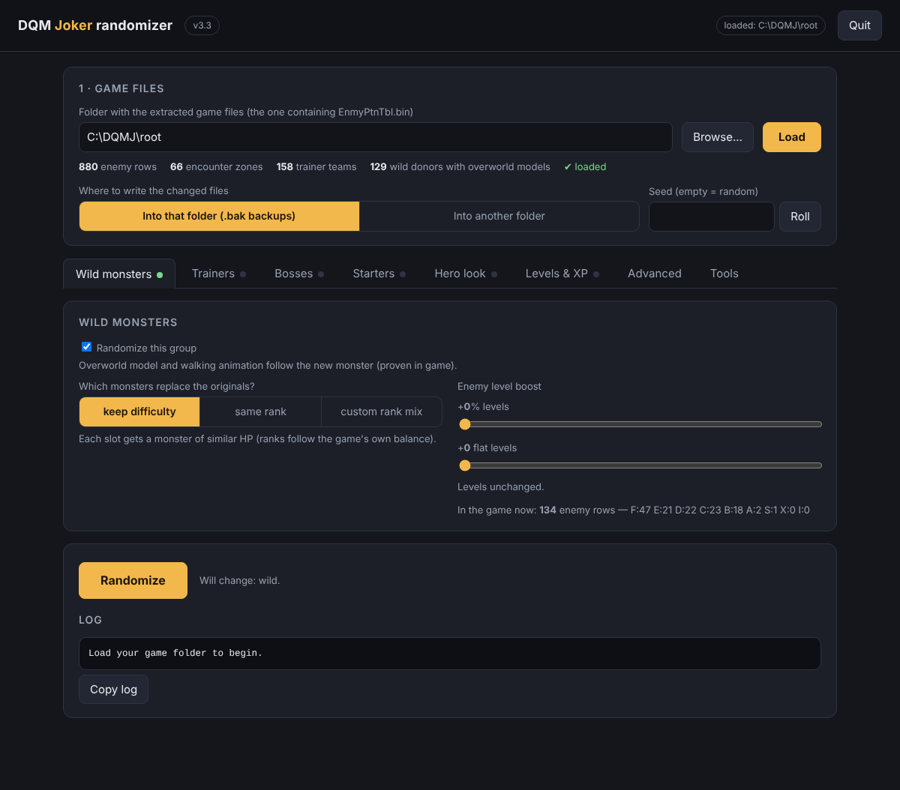

# DQM Joker Randomizer

A single-file randomizer and difficulty tuner for **Dragon Quest Monsters: Joker** (Nintendo DS, European version).
Python 3 only, no extra packages, with a simple local web interface or a command line.



> ## ⚠️ Legal notice and your responsibility — please read
>
> - **This repository contains no game data.** No ROM, no extracted files, no modified game files. Only the tool's code.
> - **You must own a legal, official copy of Dragon Quest Monsters: Joker** (the original cartridge) and make the ROM dump yourself, for personal use. Do not download ROMs from the internet.
> - **Never share, upload or distribute** a ROM, extracted game files or the modified files this tool produces. They are copyrighted material.
> - This is an unofficial fan project. It is **not affiliated with, endorsed by or sponsored by Square Enix or Nintendo**. *Dragon Quest*, *Dragon Quest Monsters: Joker* and all related names, characters and assets are trademarks / copyrights of their owners.
> - **Use at your own risk.** The software is provided "as is" (MIT license). Always work on copies and keep backups of your ROM and your save file. The author is not responsible for corrupted ROMs or saves, or for how you obtain or use game files.

## Features

| Area | What it does |
|---|---|
| Wild monsters | Replaces every wild monster; the overworld model and walking animation follow the new monster |
| Trainers and bosses | Same randomization, each group independent |
| Ranks | Per group: *keep difficulty*, *same rank*, or a custom mix of ranks F, E, D, C, B, A, S, X and Incarni (I) |
| Level boost | Per group: +% and +flat levels |
| Level map | Stretch the game's enemy levels (1–40) onto any range, e.g. 1 → 99, with a curve and "final bosses = max level" |
| Experience | Control the XP given per kill (per wild / trainer / boss) |
| Starters | Replace Dracky, Platypunk and Mischievous Mole with random or chosen monsters (any monster, Incarni included), with level and stat boost |
| Safety | Slime Challenge keeps its slimes; Scout Proficiency Test stays completable; skill-less monsters get skills so they no longer "have no idea what to do" |
| Reproducible | Seed option and a full spoiler log |
| Experimental | Visual-only "hero look" |

More screenshots: [Trainers](docs/images/02_trainers.png) · [Bosses](docs/images/03_bosses.png) · [Starters](docs/images/04_starters.png) · [Levels & XP](docs/images/05_levels_xp.png) · [Advanced](docs/images/06_advanced.png)

## Requirements

- Your own legal ROM of **Dragon Quest Monsters: Joker (EU)**
- **A recent Python 3** (tested with 3.13 and 3.14) — <https://www.python.org/downloads/> (on Windows, tick *"Add Python to PATH"*)
- **ndstool** to extract and rebuild the ROM — part of devkitPro, or a standalone build (search "ndstool release"). Any NDS unpacker that gives the same folder layout also works.
- A DS emulator (e.g. melonDS, DeSmuME) or a flash cartridge to play the result

## Installation

1. Download `dqmj_randomizer.py` (button **Code → Download ZIP**, or the *Releases* page).
2. Put it in an empty folder, for example `C:\DQMJ\` (Windows) or `~/dqmj/` (Linux / macOS).
3. Check Python works: open a terminal in that folder and run `python --version` (or `python3 --version`).

There is nothing else to install.

## Step-by-step guide

### 1. Extract your ROM

Copy your own ROM next to the script and name it `game.nds`, then in a terminal:

```
ndstool -x game.nds -9 arm9.bin -7 arm7.bin -y9 y9.bin -y7 y7.bin -d root -y overlay -t banner.bin -h header.bin
```

You now have a `root/` folder (the game's file system). **Keep `game.nds` untouched as your backup.**
The folder you will give to the tool is the one that contains `EnmyPtnTbl.bin` (the tool checks this and tells you if it is wrong).

### 2. Start the tool

- **Double-click** `dqmj_randomizer.py`, or run `python dqmj_randomizer.py`.
- A local web page opens in your browser. **Keep the console window open** while you use it; press **Quit** in the page to stop.
- If anything goes wrong, the window never closes instantly: it shows the error, waits for a key, and writes `dqmj_randomizer_error.txt`.

### 3. Load your game files

In section **1 · Game files**, type the path of your `root` folder (or use *Browse…*) and press **Load**. You should see counts such as *880 enemy rows, 66 encounter zones*.

Choose where to write the result:
- *Into that folder (.bak backups)* — changes the files in place and keeps `.bak` copies; or
- *Into another folder* — leaves `root` untouched (recommended while experimenting).

Optional: enter a **seed** (same seed + same settings = same result), or press *Roll*.

### 4. Choose your settings (tabs)

- **Wild monsters / Trainers / Bosses** — tick *Randomize this group*, pick *keep difficulty*, *same rank* or *custom rank mix*, and optionally boost levels.
- **Starters** — tick *Patch the starters*, pick random or your own choice, set their strength.
- **Levels & XP** — stretch levels and tune experience (see recommended settings below).
- **Advanced** — Incarni in the pool, keep Slimes, Scout test safety, safe actions.
- **Hero look** — experimental, visual only.
- **Tools** — diagnostics and verification.

### 5. Randomize

Press **Randomize**. The log shows what was written, including a **spoiler log** (`spoiler_log.txt` in the output folder).

### 6. Rebuild the ROM

Make sure the changed files are in the `root` folder you extract from (copy the output folder's files over a **copy** of `root` if you wrote elsewhere), then:

```
ndstool -c new.nds -9 arm9.bin -7 arm7.bin -y9 y9.bin -y7 y7.bin -d root -y overlay -t banner.bin -h header.bin
```

Load `new.nds` in your emulator or flash cart. Back up your save file first; use a fresh save to be safe.

## Recommended settings for a balanced run

Goal: a smooth start (enemies around level 1), an endgame near the top, and the final bosses at the maximum level.

On the **Levels & XP** tab:

| Setting | Value | Result |
|---|---|---|
| Level map | `1:99:1.3` | L5→6, L10→16, L15→27, L20→39, L25→53, L30→68, L35+→99 |
| Final bosses from | `35` | enemies of original level ≥ 35 get exactly 99 |
| XP battles per level | `6` wild / `8` trainer / `2` boss | one level takes about that many kills |

Equivalent command line:

```
python dqmj_randomizer.py randomize --root root --trainers --bosses --level-map 1:99:1.3 --final-from 35 --xp-battles-wild 6 --xp-battles-trainer 8 --xp-battles-boss 2 --seed 1234
```

Note: only monster growth types 9–16 (mostly S / X / Incarni) can reach level 99; others stop around 37–51. Plan the endgame party accordingly.

## Command line

```
python dqmj_randomizer.py --help
python dqmj_randomizer.py inspect --root root          # check the files
python dqmj_randomizer.py randomize --root root --seed 42
python dqmj_randomizer.py restore --root root          # restore the .bak backups
```

Commands: `gui` (default), `inspect`, `diag`, `randomize`, `restore`, `verify-rom`, `scan-code`, `starters-scan`.

## Known limitations

This is a first release, built by reverse engineering on extracted files. Be aware:

- **Not exhaustively tested in game.** Wild/trainer/boss randomization and starters were confirmed working by the author's playtesting; the following are **unverified**: the experience field used by the XP controls, the "no idea what to do" fix, the hero look, and the exact behaviour of level-99 bosses.
- **Not implemented:** synthesis (breeding) randomization, HD textures, playable story characters, dynamic boss scaling.
- European version only.
- Always keep backups; report problems in the Issues tab with your settings and seed.

## Troubleshooting

- *The window closes at once on double-click* — run it from a terminal (`python dqmj_randomizer.py`) and read the message, or open `dqmj_randomizer_error.txt`.
- *"Folder is not valid"* — pick the folder that directly contains `EnmyPtnTbl.bin`.
- *Python not found* — reinstall Python and tick *Add Python to PATH*.

## Contributing

Issues and pull requests are welcome. Never attach ROMs or game files; describe the problem, your settings and the seed instead.

## License

Code: [MIT](LICENSE). The license does not cover any game data.
